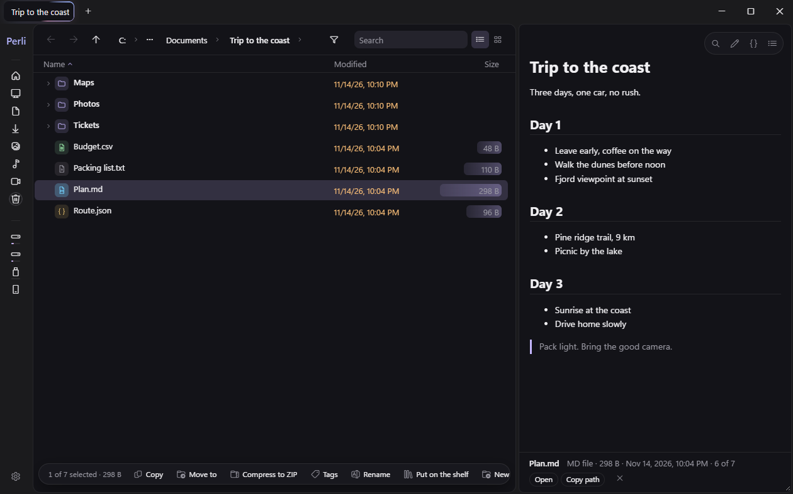
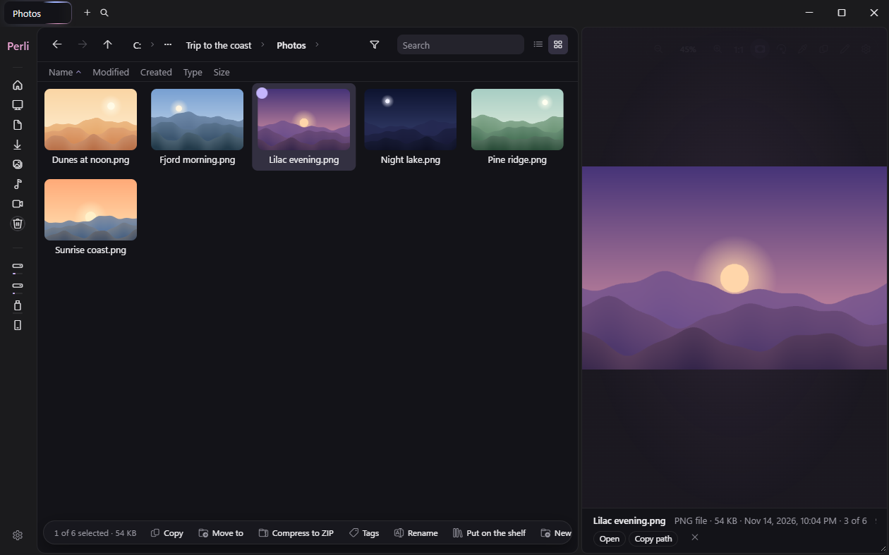
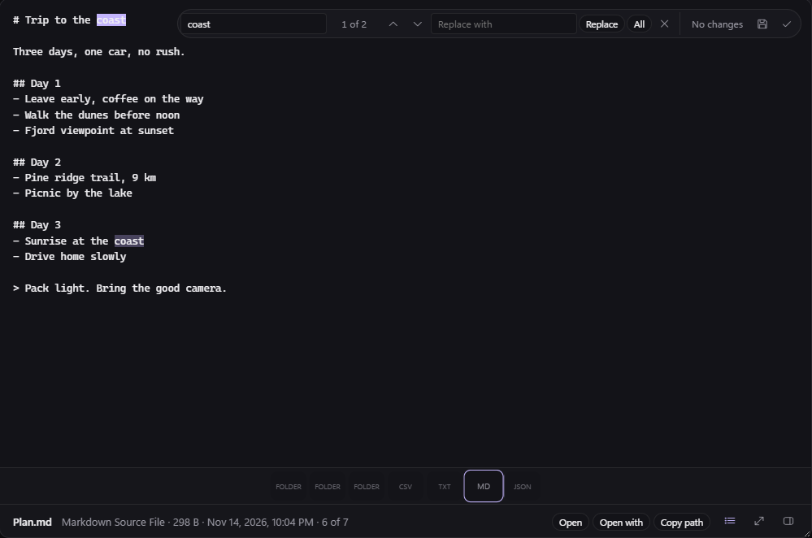
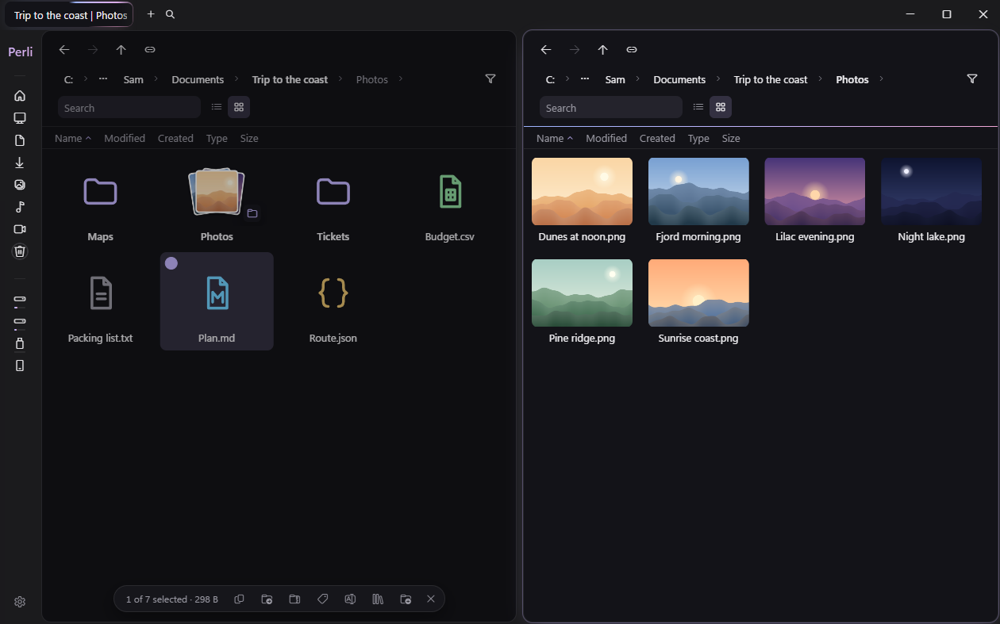
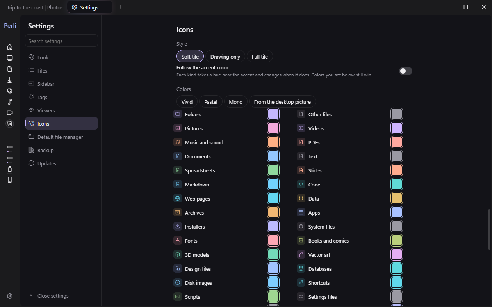

<h1 align="center">Perli</h1>

<p align="center">A calm, fast file explorer for Windows.</p>

<p align="center">
  <a href="https://github.com/dzyfps-git/perli/releases/latest"><b>Download for Windows</b></a>
  &nbsp;·&nbsp;
  <a href="#whats-inside">What's inside</a>
  &nbsp;·&nbsp;
  <a href="#keys">Keys</a>
</p>

<p align="center">
  
</p>

Perli puts the things you reach for every day one key away, and keeps everything else out of sight
until you need it. Your files come first: every change can be undone, and nothing is ever
half-written.

## What's inside

<table>
  <tr>
    <td width="50%"></td>
    <td width="50%"></td>
  </tr>
  <tr>
    <td><b>See it before you open it.</b> Space previews pictures, video, music, PDFs, fonts, books,
    comics, archives, tables and code, or keep a preview pane beside the list.</td>
    <td><b>Fix it right there.</b> Turn, mirror, crop and resize pictures. Edit text and Markdown with
    find and replace. Every save can be undone.</td>
  </tr>
  <tr>
    <td width="50%"></td>
    <td width="50%"></td>
  </tr>
  <tr>
    <td><b>Two places at once.</b> Tabs, split view, a command palette and a path you can type.
    Tear a tab off into its own window.</td>
    <td><b>Make it yours.</b> Icon styles and colors, folder looks, tags, and keys you can change.</td>
  </tr>
</table>

**Also in the box**

- Undo for copies, moves, renames, deletes and saves, with an activity log
- ZIP, 7z, RAR and TAR open like folders, read-only
- Compare two pictures or two text files
- Search that never runs out of results, filters, smart folders and tags
- Group by date, kind, size or tag, folder sizes and a disk map
- Set Perli as your default file manager, and switch back any time

## Keys

| | |
|---|---|
| Quick preview | <kbd>Space</kbd> |
| Command palette | <kbd>Ctrl</kbd> <kbd>P</kbd> |
| Split view | <kbd>Ctrl</kbd> <kbd>\\</kbd> |
| Go to a path | <kbd>Ctrl</kbd> <kbd>L</kbd> |
| Search | <kbd>Ctrl</kbd> <kbd>F</kbd> |
| Compare two files | <kbd>Ctrl</kbd> <kbd>Shift</kbd> <kbd>D</kbd> |
| Undo | <kbd>Ctrl</kbd> <kbd>Z</kbd> |
| Every key | <kbd>F1</kbd> |

## Install

Download the installer from the [latest release](https://github.com/dzyfps-git/perli/releases/latest)
and run it. Perli installs for your account alone, needs no administrator, and updates itself.

Perli is in alpha. The installer isn't code-signed yet, so Windows SmartScreen may warn you:
choose **More info**, then **Run anyway**.

<details>
<summary>Build it yourself</summary>

You need Node.js, Rust and the
[Tauri prerequisites for Windows](https://v2.tauri.app/start/prerequisites/).

```
npm install
npm run tauri dev
```

</details>

## Third-party code

The code that sends special places back to File Explorer and answers "Show in folder"
(`src-tauri/src/explorer.rs`) is ported from the launcher of [Files](https://github.com/files-community/Files),
Copyright (c) Files Community, under the MIT License. The full notice is at the top of that file.
